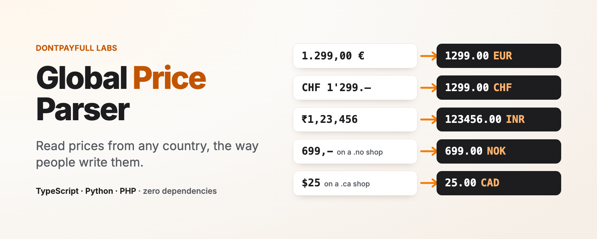

<p align="center">
  
</p>

# Global Price Parser

Read prices from text or HTML in any country: the exact amount, the
ISO 4217 currency, and an honest flag when the reading is not certain.

[](https://www.npmjs.com/package/global-price-parser)
[](https://bundlejs.com/?q=global-price-parser)
[](https://github.com/dontpayfull/global-price-parser/actions/workflows/test.yml)
[](https://github.com/dontpayfull/global-price-parser/blob/main/LICENSE)

```ts
import { parsePrice } from 'global-price-parser'

parsePrice('1.299,00 €')     // 1299.00 EUR
parsePrice("CHF 1'299.–")    // 1299.00 CHF
parsePrice('₹1,23,456')      // 123456.00 INR
parsePrice('59.900 د.ك')     // 59.900 KWD
parsePrice('$25')            // 25.00 USD, currencySure: false
parsePrice('$25', { url: 'https://shop.example.ca/p/1' })
                             // 25.00 CAD, decidedBy: 'url.tld'
```

Documentation and examples:
[dontpayfull.com/labs/global-price-parser](https://www.dontpayfull.com/labs/global-price-parser/)

- Every currency in Unicode CLDR: 162 currencies, 255 regions, symbols,
  codes and local names (`zł`, `lei`, `Kč`, `руб.`, `ر.س`).
- Reads plain text, HTML strings and DOM elements.
- When a symbol fits several currencies (`$`, `kr`, `¥`), it looks at the
  page and the URL to decide, and says when it is still not sure.
- No AI, no network, no runtime dependencies. Same input, same output.

Built at [DontPayFull](https://www.dontpayfull.com), where we track
coupon codes and deals for 20,000+ online stores in multiple countries.

## Install

```sh
npm install global-price-parser
```

Works in Node.js 18+ and in browsers. ESM and CommonJS, types
included.

Also for Python and PHP, with the same data and the same results
(checked on the same 8,700+ test cases):

```sh
pip install global-price-parser
composer require dontpayfull/global-price-parser
```

See the
[Python README](https://github.com/dontpayfull/global-price-parser/tree/main/python#readme)
and the
[PHP README](https://github.com/dontpayfull/global-price-parser/tree/main/php#readme).

## What you get back

`parsePrice` returns one `Price` or `null`:

```ts
parsePrice('$25', { url: 'https://shop.example.ca/p/1' })
```

```js
{
  amount: '25.00',         // exact, with the currency's decimals
  value: 25,               // the same amount as a number
  currency: 'CAD',         // ISO 4217, or null
  currencySure: true,      // only one currency is possible
  otherCurrencies: [],     // what else the symbol could mean
  decidedBy: 'url.tld',    // what decided the currency
  conflicts: [],           // signals that disagreed with the symbol
  symbol: '$',             // as written
  negative: false,
  ambiguous: null,         // { reason, alternative } if 2 readings
  struck: false,           // HTML only: crossed out
  per: null,               // { unit: 'kilogram', quantity: 1 }
  range: null,             // 'from' or 'to' in "$10 - $20"
  raw: '$25',              // the matched text
  index: 0                 // its position in the text
}
```

`amount` is a string so that `19.99` stays `19.99`. It has at least
as many decimals as the currency (`1299` for JPY, `1299.00` for EUR,
`59.900` for KWD); extra digits written in the price are kept
(`19,9999 €` is `19.9999`).

## Text, HTML or a DOM element

```ts
import { parsePrice, parsePrices } from 'global-price-parser'

// One price: the first one with a currency that is not struck through
parsePrice('Now 49,90 € instead of 59,90 €')

// Every price with a currency
parsePrices('Abo: 9,99 €/Monat, Set ab 1.299,00 €')
// 9.99 EUR per month, 1299.00 EUR

// HTML string: tags, entities, struck prices, <sup> cents
parsePrices('<del>$79.99</del> <ins>$59<sup>99</sup></ins>')
// 79.99 (struck: true), 59.99

// A DOM element, in the browser or with jsdom
parsePrice(document.querySelector('.product-price'))
```

How big is the discount? The struck price and the new one, both read:

```ts
const [was, now] = parsePrices('<del>$79.99</del> $59.99')
Math.round((1 - now.value / was.value) * 100)   // 25 (% off)
```

This is the check behind every deal and coupon code on
[DontPayFull](https://www.dontpayfull.com): the price before, the
price after, in the shop's own currency.

In HTML it:

- joins a price split over several elements
  (`<span>1.299</span><span>,00</span><span>€</span>`);
- reads cents in `<sup>`, but not footnotes (`$999<sup>1</sup>`) or
  `m<sup>2</sup>`;
- marks `<del>`, `<s>` and `line-through` prices as `struck`;
- skips scripts, hidden elements and screen-reader copies, so Amazon
  style markup gives one price, not `$39.99$39.99`.

When it reads a DOM element, it also reads the signals of the page the
element is in.

## How it picks the currency

The symbol written next to the number always wins. `25 €` is EUR on any
page. Page and URL signals only choose between the currencies a symbol
can mean: `$` can be USD, CAD, AUD, MXN and 26 more; `kr` can be SEK,
NOK, DKK or ISK.

Signals, in the order they count:

| Source | Example | `decidedBy` |
|---|---|---|
| Your options | `{ currency: 'CAD' }`, `{ country: 'NO' }`, `{ language: 'en-CA' }` | `hint.currency`, `hint.country`, `hint.language` |
| Shop platform | Shopify active currency, BigCommerce, PrestaShop, Magento, VTEX, WooCommerce, Shopware | `page.platform:shopify` |
| Tracking | `dataLayer` ecommerce, `gtag`, `fbq`, Klaviyo | `page.tracking:datalayer` |
| Structured data | JSON-LD `priceCurrency`, microdata, `og:price:currency` | `page.jsonld`, `page.microdata`, `page.meta` |
| URL | `?currency=CAD` | `url.query` |
| Country of the page | Shopify or PrestaShop country, `?country=CA`, hreflang of the page, `<html lang="en-CA">`, `/en-ca/` or `/ca/fr/` in the path, `.ca` domain | `page.platform:shopify`, `url.query`, `url.hreflang`, `page.lang`, `url.path`, `url.tld` |
| Nothing | `$` alone | `default` |

`default` uses the most common currency for the symbol (`$` USD,
`kr` SEK, `kr.` DKK, `¥` JPY, `£` GBP, `lei` RON) and sets
`currencySure: false`.

A currency is sure only when one currency is possible. Two signals of
the same kind that disagree (a page with offers in USD and CAD) leave
it unsure, and so does a language without a region (`{ language: 'en' }`
guesses the US, it does not decide).

A signal that points to a currency the symbol cannot mean is ignored and
listed in `conflicts`. Some signals are never used because they mislead:
the Shopify base currency, `og:locale`, `<html lang>` without a region,
tags inside HTML comments or scripts, and domains like `.co`, `.io`,
`.ai` or `.ag`.

Short abbreviations that are also words or units (`R`, `L`, `KM`, `Le`)
count as a currency only when a hint or the page confirms it: `100 KM`
is a distance until the page says Bosnia.

## Options

```ts
parsePrice(input, {
  currency: 'EUR',      // the currency you know the price is in
  country: 'NO',        // the shop's country (ISO 3166-1)
  language: 'de-CH',    // the page language (BCP 47)
  url: 'https://...',   // the page URL
  page: html,           // page HTML or Document to read signals from
  html: true,           // force HTML mode for a string
})
```

All optional. A number without a currency, like `19,99`, takes its
currency from these options or from the page. That applies to
`parsePrice` only: `parsePrices` lists numbers written with a currency.

## Formats it reads

| Written as | Reads as |
|---|---|
| `1.299,00 €`, `1 299,00 €`, `€1,299.00` | 1299.00 EUR |
| `CHF 1'299.–`, `Fr. 1’299.50` | 1299.00 CHF, 1299.50 CHF |
| `12,-`, `3.999.-`, `5 990.-` | 12.00, 3999.00, 5990.00 |
| `₹1,23,456` | 123456.00 INR |
| `¥12,800` | 12800 JPY (could be CNY) |
| `59.900 KWD` | 59.900 KWD |
| `٣٤٫٥٠ ر.س` | 34.50 SAR |
| `€5 99` | 5.99 EUR |
| `CHF-1'234`, `-249,80 lei` | negative amounts |
| `$10 - $20` | two prices, `range: 'from'` and `'to'` |
| `29,99 €/kg`, `4,99 €/100 g`, `199 lei/lună`, `$9.99/mo` | `per` unit, in any CLDR language |
| `1.234` with no currency | 1234.00, `ambiguous.alternative: '1.234'` |

Digits from every Unicode script (Arabic-Indic, Persian, Devanagari,
Thai and others) are read like 0-9.

## Page signals only

```ts
import { readPageSignals } from 'global-price-parser'

readPageSignals(html, { url: 'https://shop.example.com/en-au/p/1' })
// {
//   currency: [{ source: 'page.platform:shopify', currency: 'AUD' }],
//   country: [{ source: 'url.path', country: 'AU' }],
//   language: null
// }
```

## Why not `Intl.NumberFormat` or a regex

`Intl.NumberFormat` writes prices but cannot read them back. A regex like
`/[^0-9.]/g` turns `1.299,00 €` into `1.29900`. Prices on real pages mix
both separators, local symbols and markup.

If you use [price-parser](https://github.com/scrapinghub/price-parser) in
Python, this covers the same ground, plus HTML and page signals, and it
has a
[Python version](https://github.com/dontpayfull/global-price-parser/tree/main/python#readme)
too.

## Limits

- A separator followed by exactly three digits groups thousands, unless
  the currency has three decimals: `1,799 €/l` (fuel per litre) reads
  as 1799.00 EUR.
- Accounting brackets are not read as negative: `(15.00)` is 15.00.
- In plain text there is no "struck" information:
  `Was $59.99, now $39.99` gives 59.99 first. Use HTML, or
  `parsePrices` and pick yourself.
- It does not run the page's JavaScript, convert currencies, or read
  amounts written in words.

## License

[Apache-2.0](https://github.com/dontpayfull/global-price-parser/blob/main/LICENSE).
Currency, region and unit data come from
[Unicode CLDR](https://cldr.unicode.org/) (Unicode License v3), see
[NOTICE](https://github.com/dontpayfull/global-price-parser/blob/main/NOTICE).

If it is useful to you, a mention of
[DontPayFull](https://www.dontpayfull.com/) in your project is welcome.
More open source from the team:
[DontPayFull Labs](https://www.dontpayfull.com/labs/).

---

<p align="center">
Made with ❤️ by the <a href="https://www.dontpayfull.com">DontPayFull</a> team<br>
<sub>Coupon codes and deals for 20,000+ online stores</sub>
</p>
